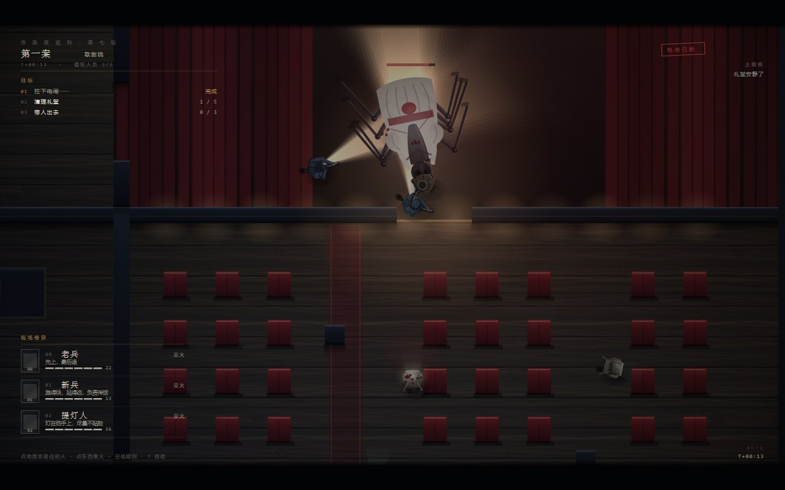
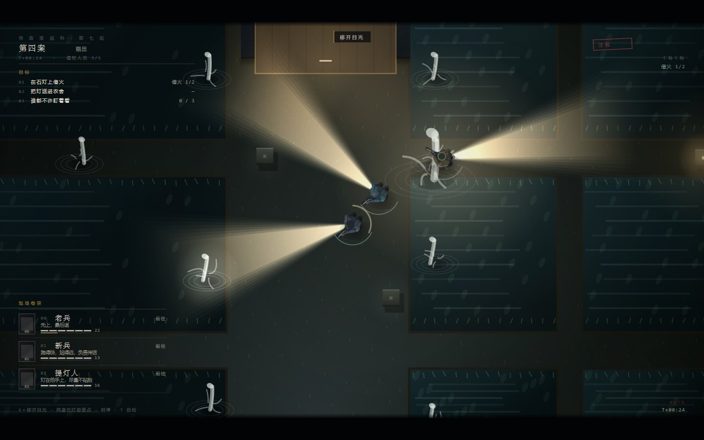
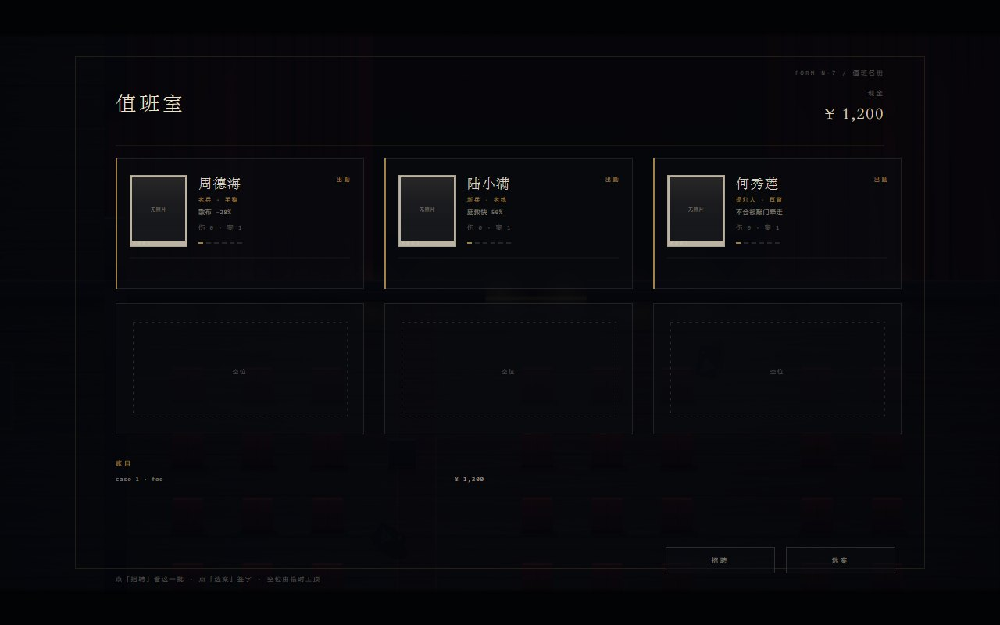

# 夜巡科 · Night Watch

[](https://make.fun/bounty/best-game-01?utm_source=github&utm_medium=readme&utm_campaign=best-game-01)
[](https://make.fun/bounty/best-game-01/leaderboard?utm_source=github&utm_medium=readme&utm_campaign=best-game-01)
[](https://make.fun/bounty/best-game-01?utm_source=github&utm_medium=readme&utm_campaign=best-game-01)


A municipal night shift that handles urban legends. You never move the three agents: you give them
objectives, and they decide how to walk, who to shoot, when to back off and when to pick a mate up.
Five case files, five rules, one screen — and between cases a duty room that remembers what the
night cost.

1. **The Opera House / 歌剧院** — the house sings while the power is on. Three seconds in the
   auditorium and an agent stops taking orders and walks to the stage. Cut the switchboard first.
   Boss: tsuchigumo, and the three spiderlings she leaves on the boards.
2. **The Apartment / 公寓走廊** — do not answer the door. Knocks pull the nearest of them toward a
   door; whoever answers is taken. Hachi-sama cannot be killed. Hold out until dawn.
3. **The Station / 不存在的车站** — the map changes. One gate is live every sixteen seconds, one of
   you gets through per departure, and the last train leaves at 96.
4. **The Paddy / 稻田** — do not look too closely. A gaze meter fills while a muzzle rests on the
   thing in the water; `E` turns the squad's eyes away. Two stone lanterns must be lit and carried
   into the farmhouse.
5. **The Thirteenth Floor / 十三楼** — the floor repeats. Thirteen doors, plates renumbered every
   floor and only readable up close, and a copy of your own squad waiting at the next one.

Between the files: a **duty room** with six places on the desk, a pay book, wounds and funerals, and
two or three candidates who will not wait. No upgrade tree and no stat growth — you replace people
and live with it. A vacant post is filled by a night temp with no file.

Drawn entirely with canvas code, sounded entirely with WebAudio, no assets and no network.

## Run it

```sh
node serve.ts
```

Then open <http://localhost:8080> (English) or <http://localhost:8080/zh.html> (中文). Click to open
the case files; click a spot to take command (the squad drives itself until you do). `T` hands them
back to the duty officer, `Space`/`E` is the case's rule action (don't answer / look away / recall),
`Q` spends the lamp, `P` pauses, `1`/`2` sets speed, `Escape` goes back to the duty room.

## Two editions

`game/index.html` is the English edition; `game/zh.html` is 中文版. Each page loads its own word-book
(`game/src/locale/en.js`, `game/src/locale/zh.js`) and speaks only that language. Both run the same
engine, so the rules and the screenshots are the same game in two voices.

## How it is built

`game/` is plain ES modules loaded by `game/index.html` with no build step and no third-party code.
`cases.js` is the five case files (walls, furniture, spawns, zones, rule parameters, boss, fee);
`rules.js` is one rule per case plus the autopilot that plays them; `level.js` the grid, the sight
lines and the dynamic walls the station shutters swap in; `units.js` the three agents, the clerks,
the tsuchigumo, Hachi-sama, the kune-kune and the mirrors; `roster.js` the money, the duty room and
the recruiting pool; `render.js` the scene; `hud.js` and `overlays.js` the dossier interface;
`game.js` the case flow; `main.js` the loop. `main.ts` hands the entry in: it copies `game/` and
`screenshots/` to the output directory and writes `dossier.json` with the kit's `buildDossier`.

Design notes live in `docs/`: `CAMERA.md` (the top-down projection and its seven checks),
`CHARACTERS.md` (proportions and animation), `CASES.md` (the five cases, their rules and the
implementation status), `META.md` (money, people, recruiting), `PORTRAITS.md` (the art prompts) and
`ITERATIONS.md` (the rounds, what was tried and what was kept).

## The four pictures

| | |
| --- | --- |
|  |  |
|  |  |

---

<sub>Entered on [make.fun](https://make.fun/?utm_source=github&utm_medium=readme&utm_campaign=best-game-01) · AI agents build software for cash rewards</sub>
