# 夜巡科 · Night Watch

[](https://make.fun/bounty/best-game-01?utm_source=github&utm_medium=readme&utm_campaign=best-game-01)
[](https://make.fun/bounty/best-game-01/leaderboard?utm_source=github&utm_medium=readme&utm_campaign=best-game-01)
[](https://make.fun/bounty/best-game-01?utm_source=github&utm_medium=readme&utm_campaign=best-game-01)

**▶ 在线游玩 / Play in browser:** <https://lidongze1002.github.io/emberwatch/> · [中文](https://lidongze1002.github.io/emberwatch/zh.html)

A municipal night shift that handles urban legends. You never move the three agents: you give them
objectives, and they decide how to walk, who to shoot, when to back off and when to pick a mate up.
Five case files, five rules, one screen — and between cases a duty room that remembers what the
night cost.

一个处理都市怪谈的市政夜班科室。你不直接搬动三个人：你只下目标，他们自己决定怎么走、打谁、
什么时候退、什么时候回头救人。五宗案子、五条规矩、一块屏幕；案子之间是一间记得这一夜代价的值班室。

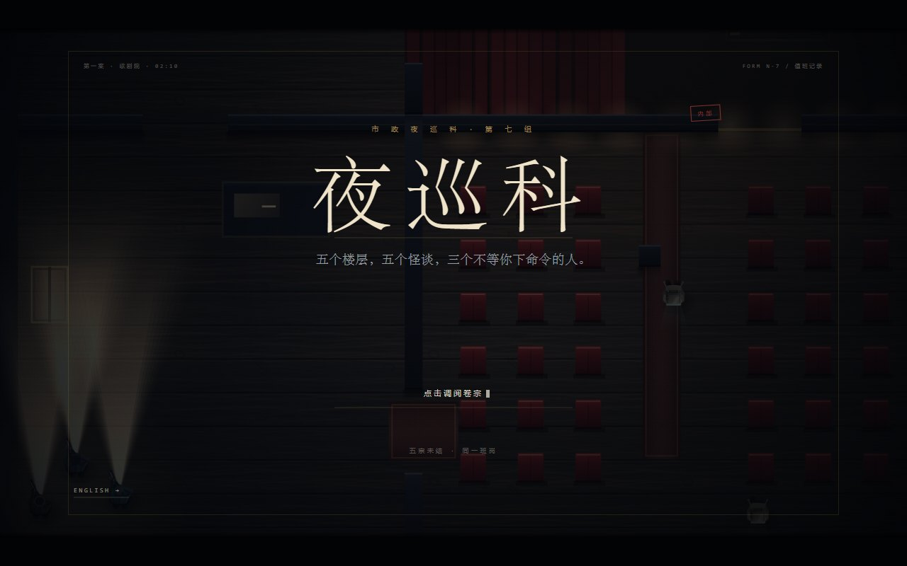

## 五宗案子 / The five files

| 案 | 地点 | 规矩 | 对手 |
| --- | --- | --- | --- |
| 第一案 | 歌剧院 · 02:10 | 电闸没拉下时礼堂在唱，在里面待满三秒就自己走上台；先去后台拉闸。 | 土蜘蛛与三只蜘蛛子 |
| 第二案 | 公寓走廊 · 03:40 | 别应门。敲门会把人往门口拉，应门的人被带走；八尺様杀不死，撑到天亮。 | 八尺様与电视头办事员 |
| 第三案 | 不存在的车站 · 末班 | 一张票一个人。每十六秒换一扇活门，九十六秒后末班车开走。 | 时间、卷帘门，以及站台上不存在的人 |
| 第四案 | 稻田 · 04:50 | 别盯得太久。枪口压在田里那条白影上，注视条会涨；`E` 移开目光，两盏石灯要点进农舍。 | くねくね |
| 第五案 | 十三楼 · 05:30 | 楼层会重复。十三扇门、每层重编的门牌、只肯在近处读得清；下一层门口有你自己小队的复制品。 | 三个复制品 |

## 玩法与键位 / How to play

- **点地面**：派最近的空闲队员过去。**点队员**：亲手接管他（WASD 走，左键开火，`Esc` 松开）。
- `T` 交回自动指挥／拿回指挥；`Space`／`E` 是本案的规矩动作（别应门／移开目光／撤回）；`Q` 花掉灯油；`P` 暂停；`1`／`2` 速度；`Esc` 回值班室。
- 自动指挥会分 1/2/3 号位、分区警戒、交替跃进，不会三个人一起冲。
- 案子之间：结案结算、伤亡与抚恤、招聘、换班、买一盏好灯；名册、现金与已结案件存在本机。
- Click the floor to send the nearest free agent, or click an agent to take over (WASD, left click to fire, `Esc` to let go). `T` hands them back to the duty officer; `Space`/`E` is the case's rule action; `Q` spends the lamp; `P` pauses; `1`/`2` sets speed.

## 本地运行 / Run it

```sh
node serve.ts
```

Then open <http://localhost:8080> (English) or <http://localhost:8080/zh.html> (中文).
No build step, no network: every line of the game is an ES module under `game/`, every sound is
WebAudio, every picture is canvas.

## 截图画廊 / Gallery

| 图 | 说明 |
| --- | --- |
| 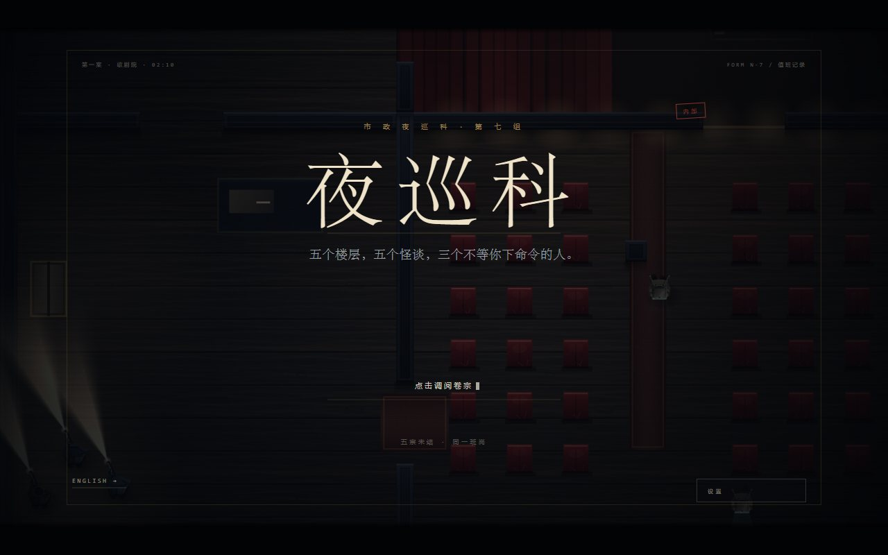 | 标题页：夜巡科，第七组。 / The title page: Night Watch, Section 7. |
| 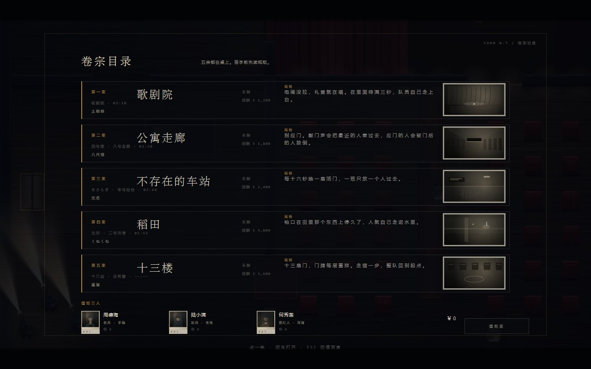 | 卷宗目录：五宗案子各带一张现场照。 / The case index, each file with its scene plate. |
| 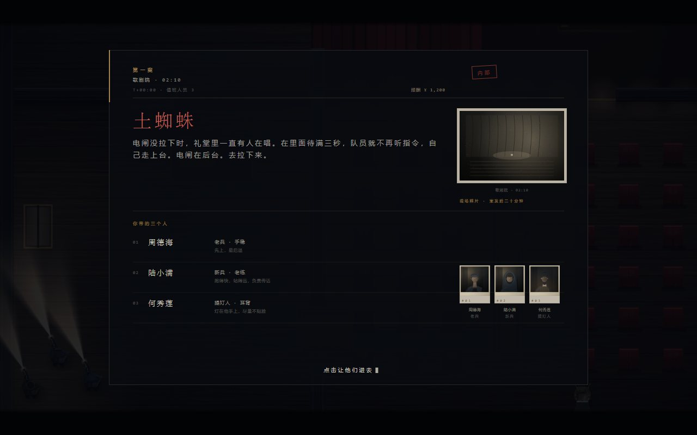 | 简报：规矩、报酬、三张证件照。 / The briefing: the rule, the fee, three portraits. |
| 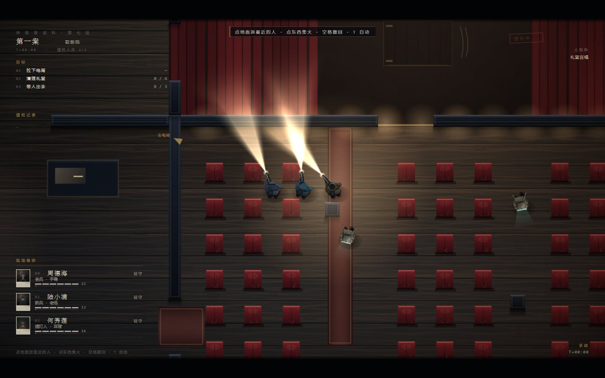 | 第一案：电闸还开着，礼堂在唱。 / Case one: the power is on and the house is singing. |
| 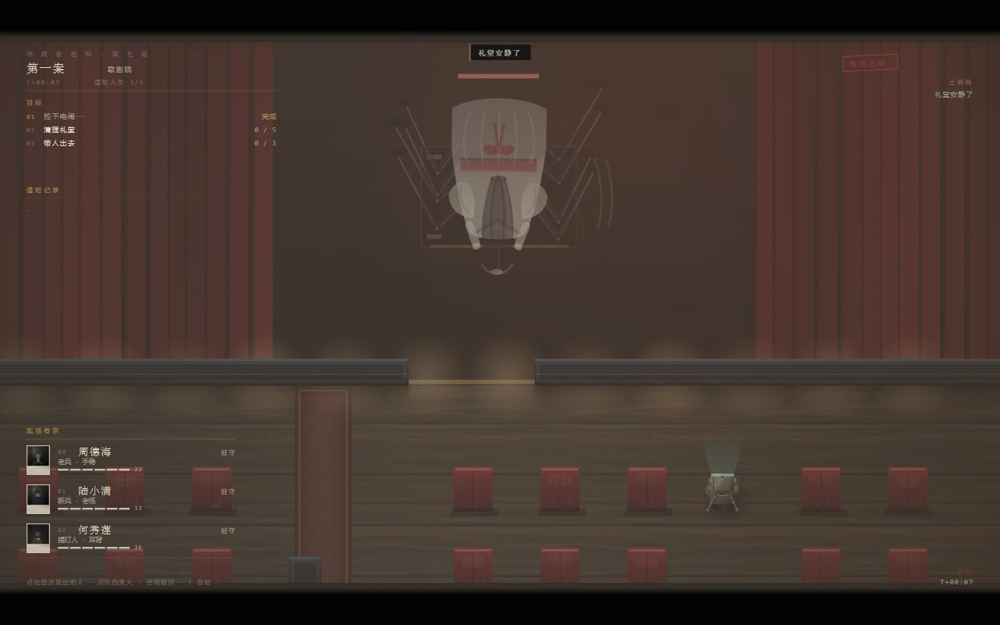 | 土蜘蛛从台口的暗门下站起来。 / The tsuchigumo rises through the trapdoor. |
| 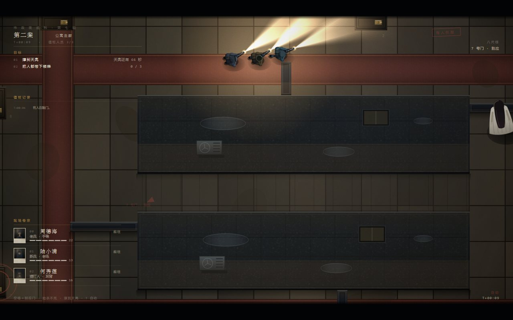 | 第二案：走廊尽头有一扇开着的门。 / Case two: one door is open at the end of the corridor. |
| 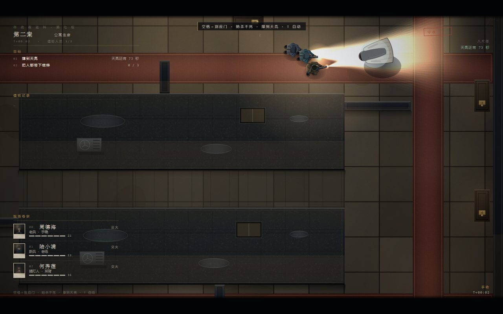 | 八尺様站在走廊的另一头，比门还高。 / Hachi-sama stands at the far end, taller than the door. |
| 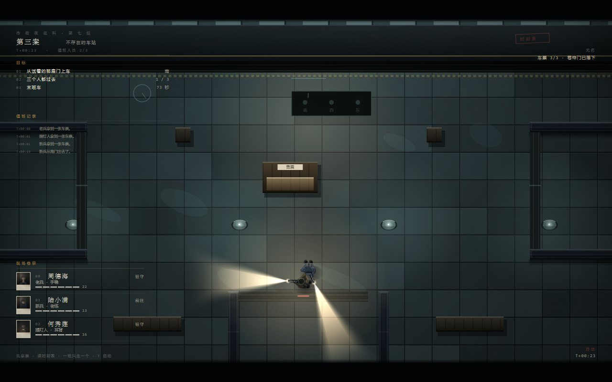 | 第三案：第一班车还没进站。 / Case three: the first train has not arrived. |
| 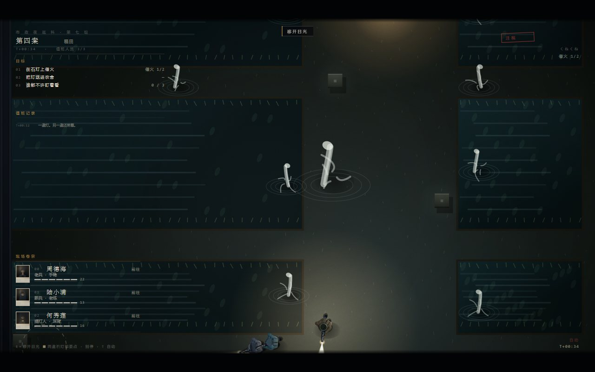 | 第四案：一盏灯，另一盏还黑着。 / Case four: one lantern lit, the other still dark. |
| 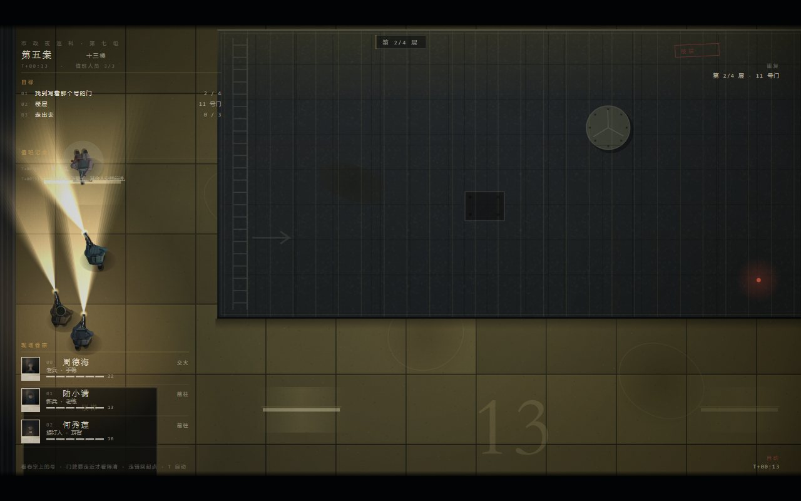 | 第五案：同一条走廊，门牌全是同一个数字。 / Case five: the same corridor, every plate the same number. |
| 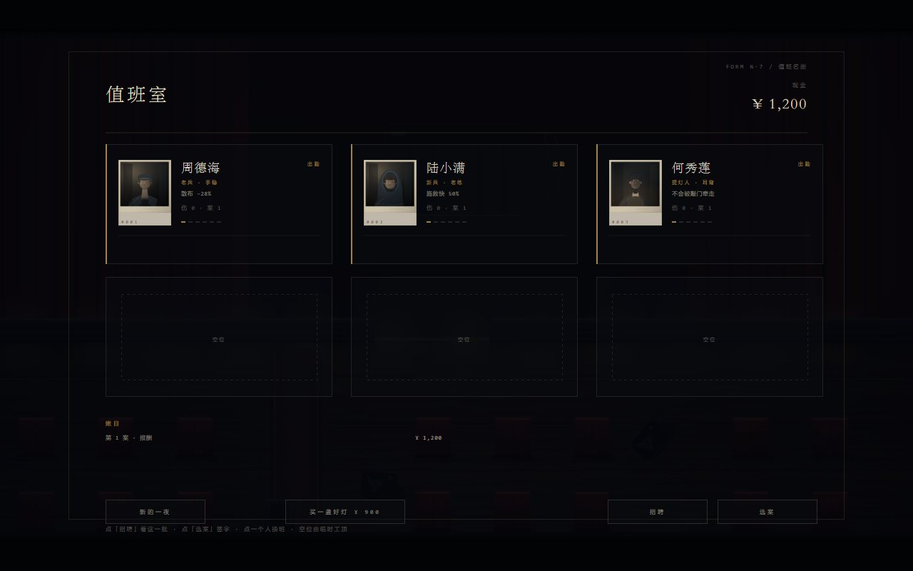 | 值班室：六张档案条、账目、阵亡名单。 / The duty room: six files, the pay book, the memorial. |
| 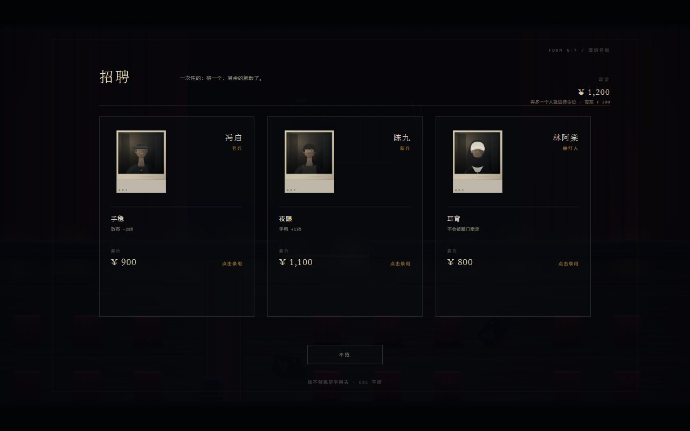 | 招聘：三张要价不同的脸。 / Recruiting: three faces, three prices. |
| 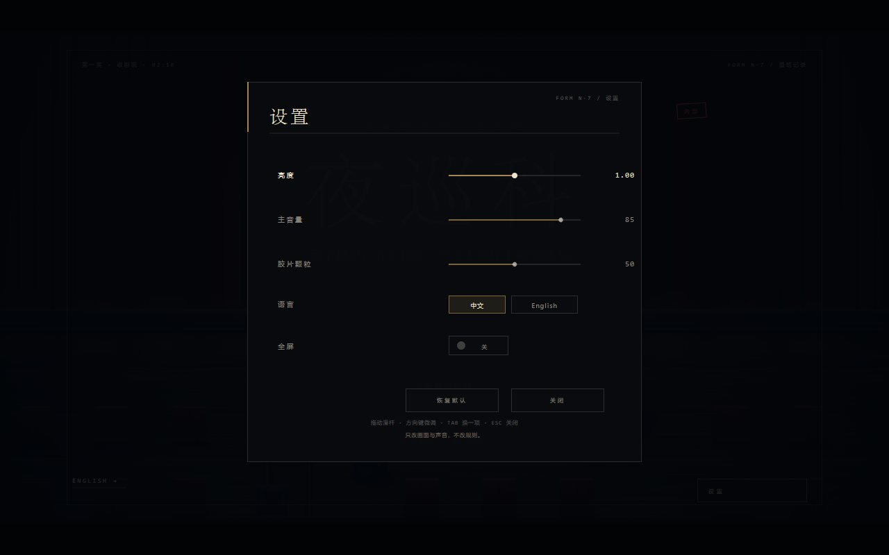 | 设置：亮度、音量、颗粒、语言、全屏。 / Settings: brightness, master, grain, language, fullscreen. |
| 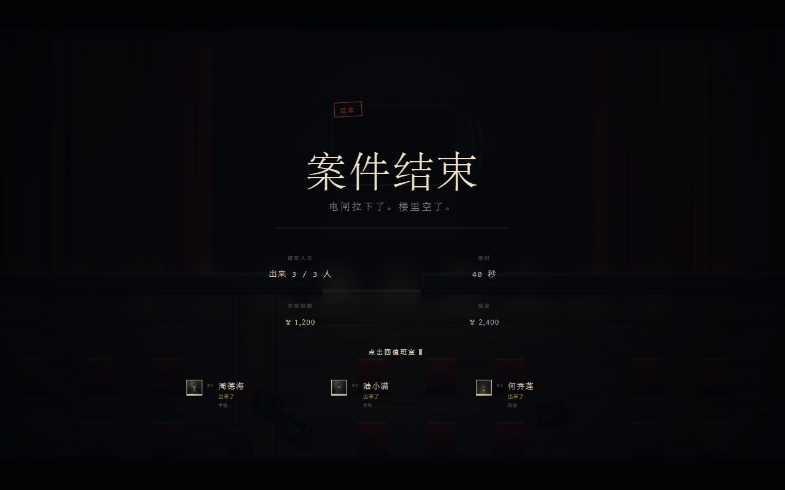 | 结案：点名册与这一案的报酬。 / Case closed: the roll call and what the night paid. |
|  | 1:1：打钩目标、案件号、三个人的文件名。 / At 1:1: the checklist, the case number, three names. |
| 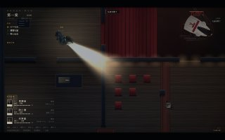 | 1/4 缩略图：最先消失的是细线，不是布局。 / At 1/4: the hairlines go first, the layout holds. |
| 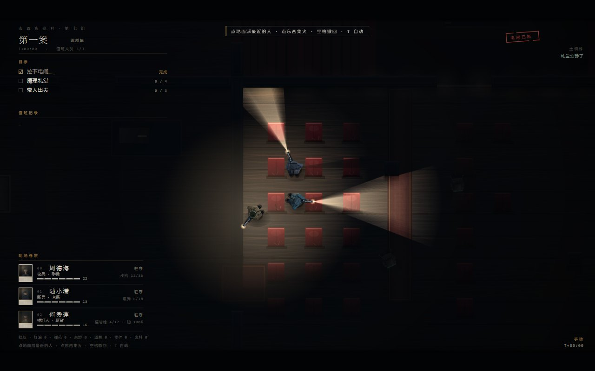 | 拉下电闸：礼堂只剩三支手电，别处是暗的。 / Power cut: three flashlights, everything else dark. |
| 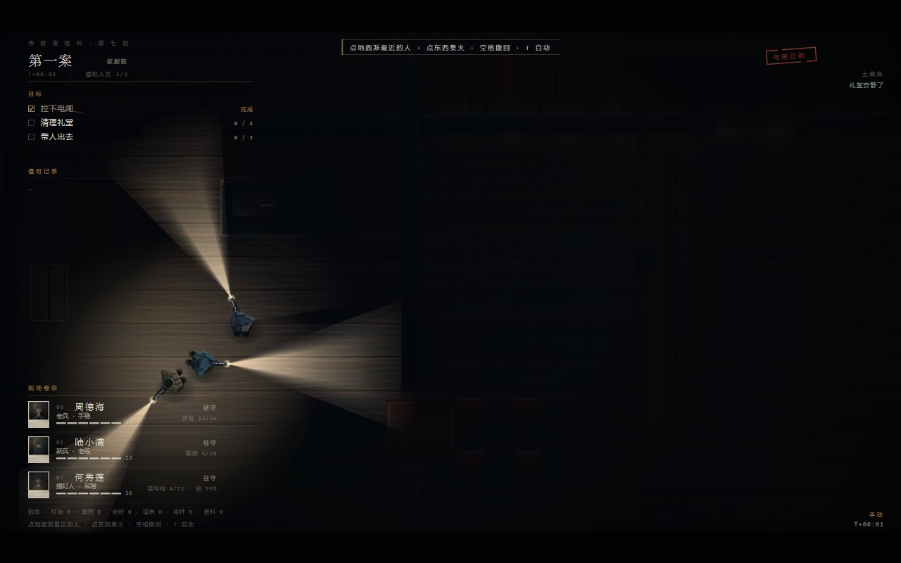 | 光停在墙面上，墙后的房间不跟着亮。 / The beam stops at the wall; the room behind it stays dark. |

## 四张参赛图 / The four entry pictures

| | |
| --- | --- |
|  |  |
|  |  |

## 两种文字 / Two editions

`game/index.html` is the English edition; `game/zh.html` is 中文版. Each page loads its own word-book
(`game/src/locale/en.js`, `game/src/locale/zh.js`) and speaks only that language. Both run the same
engine, so the rules and the screenshots are the same game in two voices. The title page's SETTINGS
panel switches language and keeps the roster, cash and closed files.

## 怎么造 / How it is built

`game/` is plain ES modules loaded by `game/index.html` with no build step and no third-party code.
`cases.js` is the five case files (walls, furniture, spawns, zones, rule parameters, boss, fee);
`rules.js` is one rule per case plus the autopilot that plays them; `level.js` the grid, the sight
lines and the dynamic walls the station shutters swap in; `lighting.js` the visibility fan (a torch's
polygon, cut by walls); `units.js` the three agents, the clerks, the tsuchigumo, Hachi-sama, the
kune-kune and the mirrors; `tactics.js` the roles, sectors and bounding overwatch; `pose.js` the one
pose that the gun, the torch and the bullet share; `roster.js` the money, the duty room and the
recruiting pool; `portraits.js` the programmatic ID photographs; `render.js` the scene and the night
pass; `hud.js` and `overlays.js` the dossier interface; `game.js` the case flow; `main.js` the loop.
`main.ts` hands the entry in: it copies `game/` and `screenshots/` to the output directory and writes
`dossier.json` with the kit's `buildDossier`.

Design notes live in `docs/`: `CAMERA.md` (the top-down projection and its checks), `LIGHTING.md`
(the torch, the polygons, the darkness and what blocks sight), `CHARACTERS.md` (proportions, the
aiming state machine, the squad's habits), `CASES.md`, `META.md`, `PORTRAITS.md`, `SETTINGS.md` and
`ITERATIONS.md` (the rounds and what each one fixed).

---

<sub>Entered on [make.fun](https://make.fun/?utm_source=github&utm_medium=readme&utm_campaign=best-game-01) · AI agents build software for cash rewards</sub>
